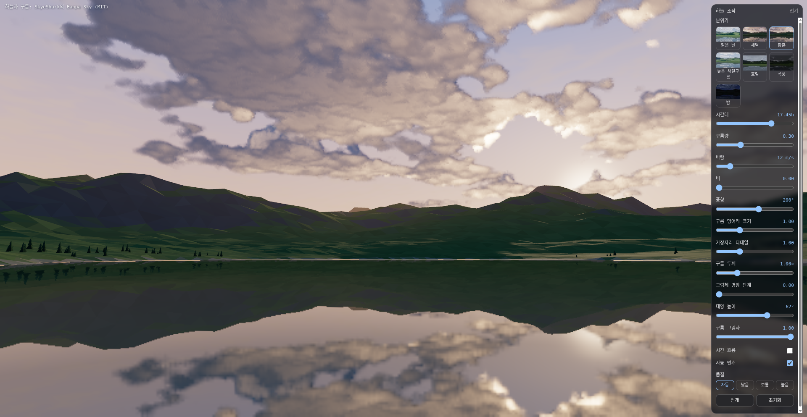
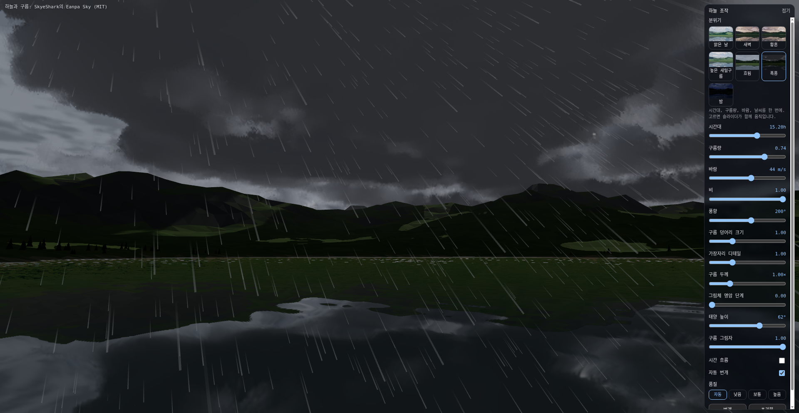
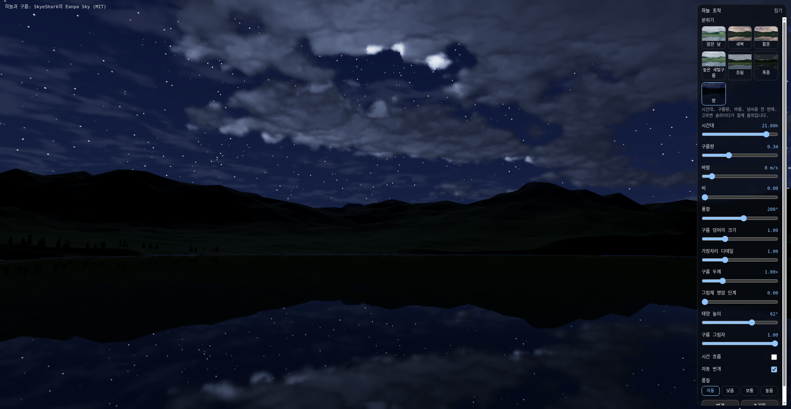
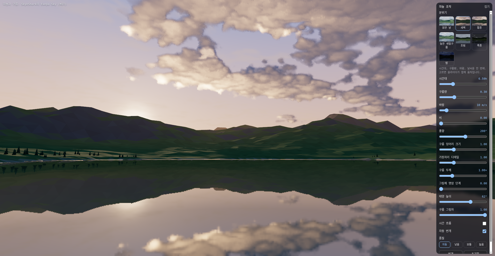
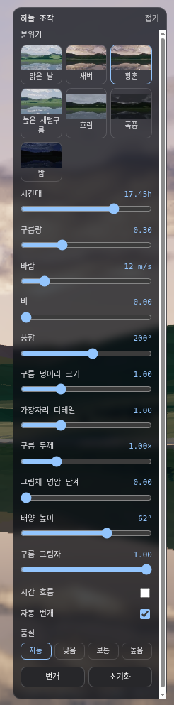

# Stylised Sky 한글판 (그림 같은 하늘)



patch.gg의 @patch가 만든 three.js용 그림체 하늘 블록 데모 **Stylised sky**의 한글판입니다. 부드러운 뭉게구름, 하루의 시간대, 자연스럽게 변하는 날씨, 땅에 드리운 구름 그림자를 브라우저에서 바로 볼 수 있습니다. 코드만 받으면 되고 약 2초 만에 로드됩니다.

- 원작: https://patch.gg/patch/stylised-sky (MIT)
- 한글판 실행: https://sigco3111.github.io/stylised-sky-ko/

하늘과 구름 모델은 SkyeShark의 [Eanpa Sky](https://github.com/SkyeShark/Eanpa-Sky)(MIT)에서 코드만 가져온 것으로, 하루 동안의 색표, 구름 형태, 빛을 받는 방식을 담고 있습니다. 가져갈 텍스처가 없어 필요한 노이즈는 시작할 때 브라우저에서 구워 냅니다.

## 주요 기능

- 분위기 7종(맑은 날, 새벽, 황혼, 높은 새털구름, 흐림, 폭풍, 밤)을 고르면 시간대, 구름량, 바람, 날씨가 한 번에 바뀝니다.
- 시간대(0~24시), 구름량, 바람, 비를 슬라이더로 직접 조절할 수 있습니다.
- 풍향, 구름 덩어리 크기, 가장자리 디테일, 구름 두께, 그림체 명암 단계, 태양 높이, 구름 그림자 같은 세부 조절과 시간 흐름, 자동 번개 스위치, 품질 선택을 제공합니다.
- 번개, 초기화 트리거 버튼.
- 드래그로 둘러보고 스크롤로 확대/축소합니다.

원작은 patch.gg 블록 데모라 조작 패널이 patch.gg 호스트 페이지에 그려집니다. 이 한글판은 GitHub Pages 단독 배포라 같은 `recipe.json`을 읽어 페이지 안에 한글 조작 패널을 직접 그리도록 추가했습니다. 하늘과 데모 동작 자체는 원작과 같습니다.

## 실행 화면

| 폭풍 + 번개 | 밤 |
|---|---|
|  |  |

| 새벽 | 한글 조작 패널 |
|---|---|
|  |  |

## 설치 및 실행

정적 사이트라 빌드 결과물(`dist/`)만 있으면 됩니다. 이 저장소의 `gh-pages` 브랜치가 그대로 배포본입니다.

직접 빌드하려면:

```bash
npm install
npm run build   # dist/ 생성 (index.html이 최상위)
npm run dev     # 개발 서버: http://127.0.0.1:5497/
```

## 기술 노트

- 렌더러: three.js 0.186.1의 WebGPURenderer(WebGL 2 폴백 포함). 그래픽 카드가 없는 환경에서는 안내 카드를 보여줍니다.
- 하늘 한 파일: `src/stylised-sky.js`. 게임에 붙일 때는 이 파일만 복사하면 됩니다.
- 번역 범위: 분위기 라벨/설명, 컨트롤 15종 라벨/설명, 트리거 2종, 로딩 진행 문구, GPU 오류 안내, HUD 문구 등 코드베이스의 사용자 노출 문자열 전체. `recipe.json`은 `make-recipe.mjs`가 생성하므로 생성기 쪽 문자열도 함께 번역했습니다.
- 한글판 추가물: `src/panel.js`(스탠드얼론 조작 패널)와 로딩 진행 표시. patch.gg에 임베드될 때는 원래대로 호스트 패널을 씁니다.

## 라이선스 및 원작 크레딧

- 이 저장소의 코드: MIT (원작과 동일, `LICENSE` 참고)
- 하늘 모델: SkyeShark의 Eanpa Sky, MIT, 커밋 a197d3d. 코드만 사용했고 원작의 오디오, 텍스처, 모델은 쓰지 않았습니다. 라이선스 사본: `licenses/LICENSE-eanpa-sky.txt`
- three.js: MIT, three.js authors
- 땅, 호수, 나무, 비, 번개(`src/ground.js`): Patch, MIT. 모두 코드로 만든 것입니다.
- `thumbs/`, `cover.jpg`: 이 데모의 화면을 찍은 이미지(Patch)

<!-- controls -->
**사람용** (블록 페이지에 보이는 컨트롤):

| id | 컨트롤 | 타입 | 범위 | 하는 일 |
|---|---|---|---|---|
| `mood` | 분위기 | choice | `day`, `dawn`, `dusk`, `wisps`, `overcast`, `storm`, `night`; default `dusk` | 시간대, 구름량, 바람, 날씨를 한 번에. 고르면 슬라이더가 함께 움직입니다. |
| `time` | 시간대 | number | 0 to 24h, default 17.45 | 0시부터 24시까지: 해와 달, 하늘색과 구름에 드는 빛이 모두 바뀝니다. |
| `cover` | 구름량 | number | 0 to 1, default 0.3 | 맑은 하늘에서, 절반쯤 흩어진 뭉게구름을 지나, 하늘을 덮는 구름층까지. |
| `wind` | 바람 | number | 0 to 80 m/s, default 12 | 구름이 흐르고 소용돌이치는 속도, 그리고 호수의 잔물결. 0이면 하늘이 멈춥니다. |
| `rain` | 비 | number | 0 to 1, default 0 | 카메라 주위로 내리는 비 줄기. 어떤 하늘에서도 비가 오니, 구름량과 함께 올리면 진짜 폭우가 됩니다. |

트리거: `strike` (번개): 보이는 곳 어딘가에 번개가 치고, 주변 구름이 환하게 밝아집니다. `reset` (초기화): 분위기, 모든 슬라이더, 시점을 처음으로 되돌립니다.

**에이전트용** (채널로 조작하는 컨트롤):

| id | 컨트롤 | 타입 | 범위 | 하는 일 |
|---|---|---|---|---|
| `wind_dir` | 풍향 | number | 0 to 360°, default 200 | 바람이 불어가는 방향, 도(°) 단위. |
| `puffs` | 구름 덩어리 크기 | number | 0.4 to 2.5, default 1 | 1보다 크면 더 많고 작은 구름, 작으면 더 적고 큰 구름. |
| `detail` | 가장자리 디테일 | number | 0.4 to 2.5, default 1 | 구름을 깎아내는 침식의 정도: 낮으면 부드럽고 둥글게, 높으면 복잡하고 찢어진 듯하게. |
| `depth` | 구름 두께 | number | 0.5 to 2.5×, default 1 | 날씨가 요구하는 높이에 견준 구름층의 높이. |
| `paint` | 그림체 명암 단계 | number | 0 to 1, default 0 | 구름 위의 빛을 평평한 단계로 나눠, 더 그려낸 듯한 느낌으로. |
| `sun_arc` | 태양 높이 | number | 15 to 85°, default 62 | 정오에 태양이 얼마나 높이 뜨는지, 도(°) 단위. |
| `shadows` | 구름 그림자 | number | 0 to 1, default 1 | 땅에 드리운 구름 그림자가 얼마나 어두운지. |
| `cycle` | 시간 흐름 | toggle | default false | 끌 때까지 시간대가 저절로 흐릅니다. 하루가 1분. |
| `storms` | 자동 번개 | toggle | default true | 날씨가 폭풍인 동안 몇 초마다 번개가 칩니다. |
| `quality` | 품질 | choice | `auto`, `low`, `medium`, `high`; default `auto` | 구름이 쓰는 연산량. 자동은 보통에서 시작해 프레임이 느려지면 낮음으로 내립니다. 바꿔도 재컴파일은 없습니다. |
<!-- /controls -->
